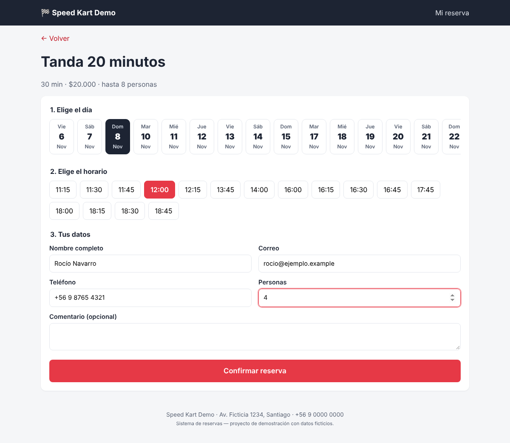
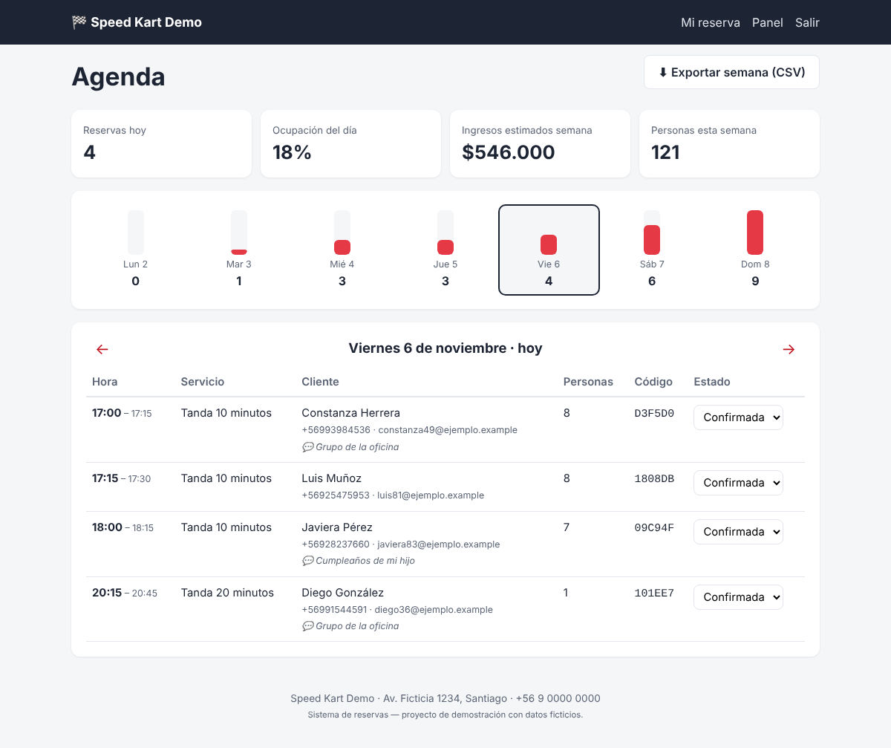

# 🏁 Sistema de reservas web

Aplicación web para que los clientes de un negocio **reserven horarios en línea**: ven la disponibilidad en tiempo real, reservan en tres pasos y reciben un código de confirmación. El negocio administra su agenda desde un **panel con indicadores**.

La demo está configurada como un centro de karting, pero sirve para **cualquier negocio que trabaje con horas**: peluquerías, canchas, consultas, talleres o clases. Para adaptarla basta con editar un archivo de configuración.

**🔗 Demo en vivo:** _[agrega aquí el link cuando la publiques]_ · Panel: `/admin` (clave de demo: `demo1234`)

| Reserva del cliente | Panel del negocio |
|---|---|
|  |  |

---

## El problema

Muchos negocios pequeños agendan por WhatsApp o por teléfono. Eso genera:

- **Horarios cruzados** y reservas duplicadas.
- Tiempo perdido respondiendo "¿tienen hora el sábado?".
- Ninguna visibilidad de cuánto se ocupa el local o cuánto se va a vender en la semana.

## Funcionalidades

**Para el cliente**
- Catálogo de servicios con duración, precio y capacidad.
- Calendario con los **horarios disponibles calculados en tiempo real**, considerando el horario de atención, las reservas existentes y la anticipación mínima.
- Reserva en 3 pasos, con un **código de confirmación** y un correo con el detalle.
- Consulta y **cancelación** de la reserva con código y correo, hasta 2 horas antes.
- Diseño adaptable a celulares.

**Para el negocio**
- **Agenda diaria** con datos de contacto y comentarios de cada cliente.
- Cambio de estado de cada reserva: confirmada, asistió, no asistió o cancelada.
- **Indicadores**: reservas del día, % de ocupación, ingresos estimados de la semana y cantidad de personas.
- Gráfico de reservas por día de la semana.
- **Exportación a CSV**, que se abre directo en Excel.

**Seguridad y robustez**
- Imposible reservar dos veces el mismo horario: se valida en el servidor y la reserva se guarda en una **transacción exclusiva**, incluso si dos personas reservan al mismo tiempo.
- Protección **CSRF** en todos los formularios.
- Panel protegido con clave.
- Consultas SQL parametrizadas.
- 12 pruebas automatizadas.

## Adaptarlo a otro negocio

Todo se configura en [`negocio.toml`](negocio.toml), sin tocar código:

```toml
nombre = "Barbería Central"
intervalo_minutos = 30

[horarios]
1 = [["10:00", "14:00"], ["15:00", "20:00"]]   # martes, con pausa de almuerzo

[[servicios]]
id = "corte"
nombre = "Corte de pelo"
duracion = 30
precio = 10000
max_personas = 1
```

## Cómo ejecutarlo

```bash
pip install -r requirements.txt
python scripts/datos_demo.py     # (opcional) carga reservas de ejemplo
python wsgi.py                   # abre http://127.0.0.1:5000
```

Para personalizar las claves, copia `.env.ejemplo` como `.env` y edítalo. Si no configuras un correo, las confirmaciones se muestran en la consola.

## Publicarlo gratis (PythonAnywhere)

1. Crea una cuenta gratuita en [pythonanywhere.com](https://www.pythonanywhere.com).
2. Abre una consola **Bash** y ejecuta:
   ```bash
   git clone https://github.com/ClaudioHub-01/reservas-web.git
   cd reservas-web
   pip install --user -r requirements.txt
   cp .env.ejemplo .env && nano .env     # cambia SECRET_KEY y ADMIN_CLAVE
   python scripts/datos_demo.py
   ```
3. En **Web → Add a new web app**, elige **Manual configuration** y la versión de Python correspondiente.
4. Edita el archivo **WSGI** que te muestra la página y reemplaza su contenido por:
   ```python
   import sys
   sys.path.insert(0, "/home/TU_USUARIO/reservas-web")
   from wsgi import app as application
   ```
5. En **Static files** agrega la URL `/static/` con el directorio `/home/TU_USUARIO/reservas-web/app/static`.
6. Presiona **Reload**. La demo queda en `https://TU_USUARIO.pythonanywhere.com`.

> En la cuenta gratuita, la app se desactiva si no se renueva cada mes: hay un botón para extenderla en la pestaña **Web**.

## Estructura

```
├── negocio.toml              # configuración del negocio (servicios, horarios, reglas)
├── wsgi.py                   # punto de entrada
├── app/
│   ├── __init__.py           # creación de la app Flask
│   ├── disponibilidad.py     # cálculo de horarios libres (lógica pura, probada)
│   ├── db.py                 # SQLite: reservas y transacciones
│   ├── rutas_publicas.py     # reservar, confirmar, consultar y cancelar
│   ├── rutas_admin.py        # agenda, estados, indicadores y exportación
│   ├── seguridad.py          # CSRF y acceso al panel
│   ├── correo.py             # confirmación por correo
│   ├── templates/            # vistas HTML (Jinja)
│   └── static/               # estilos y JavaScript
├── scripts/datos_demo.py     # reservas ficticias para la demo
└── tests/                    # pruebas automatizadas (pytest)
```

## Tecnologías

Python 3.11+ · Flask · SQLite · Jinja · JavaScript · CSS responsivo · pytest

---

> Todos los nombres, correos y reservas de la demo son **ficticios**.

**¿Tu negocio todavía agenda por WhatsApp?** Contáctame: clayer2001@gmail.com
